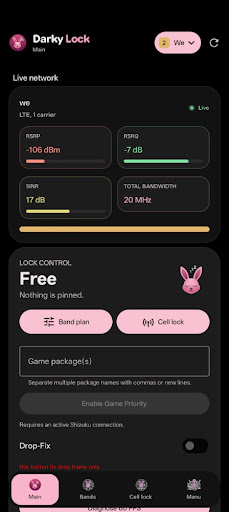
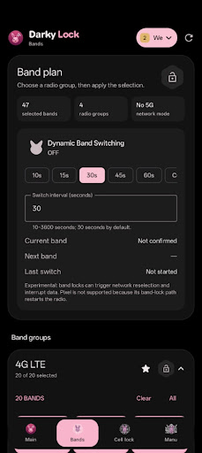
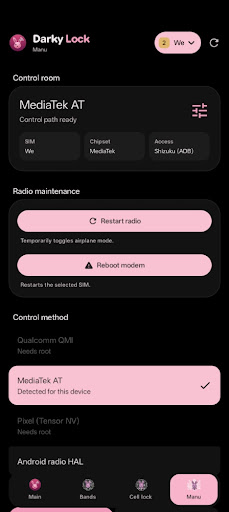

# Darkylock

<p align="center">
  
</p>

<p align="center">
  <strong>Advanced Android Cellular Band/Cell Locking & Game Performance Tool</strong>
</p>

<p align="center">
  
  
  
  
</p>

---

## 📱 App Screenshots Showcase

<div align="center">

| Live Network Status | Bands Plan | Cell Lock | Control Room & Menu |
| :---: | :---: | :---: | :---: |
|  |  |  |  |
| **Main Dashboard**<br>Displays active SIM state, serving technology (5G/LTE), signal metrics & live lock status. | **Band Selection**<br>Configure preferred LTE/5G NR band masks, custom profiles & Dynamic Band Switching. | **Cell Tower Pinning**<br>Scan nearby towers (PCI/ARFCN) and lock modem to target cells instantly. | **System & Diagnostics**<br>Manage Root/Shizuku, radio maintenance, AT/QMI console & update settings. |

</div>

---

## 🌟 Overview & Key Features

**Darkylock** is a powerful Android application designed for mobile network engineers, power users, and gamers. It provides direct hardware-level modem control across major SoC platforms (Qualcomm, MediaTek, Samsung Exynos, and Google Pixel) via Root (`su`) or [Shizuku](https://shizuku.rikka.app/), alongside frame-rate stabilization utilities.

### 📶 Cellular Network Management
* **Band Locking & Band Profiles:** Lock your modem to specific LTE and 5G NR bands to prevent unwanted band hopping and improve network throughput and latency.
* **Cell & PCI Pinning:** Scan serving and neighboring cellular towers, inspect Physical Cell Identity (PCI) and ARFCN metrics, and pin the connection to specific cells.
* **Network Selection (PLMN):** Manual network operator selection and active SIM slot binding for multi-carrier roaming scenarios.
* **Dynamic Band Switching:** Automatically switch between preferred band configurations at user-defined intervals with readback verification.

### 🎮 Game Performance Optimization (Drop-Fix)
* **Game Priority:** Enforces system-level Android Game Performance Mode (`cmd game set`) for user-selected game packages.
* **Drop-Fix Loop:** Periodically maintains game scheduling priority to reduce sudden FPS drops during active gameplay.
* **Device Health Diagnostics:** Monitors thermal throttling status, screen refresh rate mode, and battery saver conditions in real-time.

---

## 🛠️ Technical Architecture

```
+-------------------------------------------------------------+
|                      Darkylock Compose UI                   |
|       (MainActivity, MainViewModel, Jetpack Compose M3)      |
+------------------------------+------------------------------+
                               |
                               v
+-------------------------------------------------------------+
|                     ModemController (IPC)                   |
|     (Manages backend selection, SIM mapping & state flows)   |
+------------------------------+------------------------------+
                               |
            +------------------+------------------+
            |                                     |
            v                                     v
+-----------------------+             +-----------------------+
|   RootServer (su)     |             | ShizukuClient / Service|
+-----------+-----------+             +-----------+-----------+
            |                                     |
            +------------------+------------------+
                               |
                               v
+-------------------------------------------------------------+
|                   Modem Hardware Layer                      |
| (QRTR / QMI C Sockets, AT Commands, MediaTek / Samsung HAL) |
+-------------------------------------------------------------+
```

* **UI Layer:** Declarative UI built with Jetpack Compose (Material 3) supporting native RTL layout for Arabic & English.
* **IPC & Daemonless Helper:** `RootServer` (runs via `su`) and `ShizukuClient` (runs via `Shizuku`) execute system commands without running persistent background daemons when idle.
* **Native C Engine (`:modem`):** Includes compiled native QRTR socket C library (`libdarkyqrtr.so`) via CMake for direct Qualcomm modem QMI communication.

---

## 📋 Requirements & Permissions

* **Android Version:** Android 11.0 (API Level 30) or higher.
* **Target SDK:** Android 15 (API Level 37).
* **Access Level:** Root access (Magisk / KernelSU / APatch) **OR** [Shizuku](https://shizuku.rikka.app/) installed and granted.

### Manifest Declarations:
* `READ_PHONE_STATE`: Used to identify active SIM slots and match subscription IDs to hardware modem backends.
* `ACCESS_FINE_LOCATION` & `ACCESS_COARSE_LOCATION`: Mandatory for Android Telephony APIs (`TelephonyManager.getAllCellInfo()`) to query cell PCI and signal metrics.
* `POST_NOTIFICATIONS`: Displays active lock status notifications and Drop-Fix service controls.
* `FOREGROUND_SERVICE` & `FOREGROUND_SERVICE_SPECIAL_USE`: Powers the `DropFixService` to maintain user-requested game scheduling priority.

---

## 🚀 Build & Setup Instructions

### Prerequisites
* **Android Studio:** Ladybug (2024.2) or newer.
* **JDK:** Java 17.
* **Android NDK:** Version 29.0.14206865.

### Building the Project

1. **Clone the Repository:**
   ```bash
   git clone https://github.com/mo-darkylock/darkylock.git
   cd darkylock
   ```

2. **Configure App Signing:**
   Copy `keystore.properties.example` to `keystore.properties` in the root folder and add your keystore details:
   ```properties
   storeFile=release.keystore
   storePassword=YourStorePassword
   keyAlias=YourKeyAlias
   keyPassword=YourKeyPassword
   ```

3. **Build Release Android App Bundle (.aab):**
   ```bash
   ./gradlew bundleRelease
   ```
   The signed `.aab` file will be generated at `app/build/outputs/bundle/release/app-release.aab`.

---

## 🔒 Privacy & Compliance

Darkylock is built with strict privacy standards:
* **0% Data Collection:** No personal data, location history, SIM numbers, or telemetry are collected or stored outside your device.
* **100% Local Execution:** All network diagnostics and modem commands operate strictly on-device.
* **Play Store Compliant:** Fully compliant with Google Play Developer Policies regarding permissions transparency and user data safety.

Read our full [Privacy Policy](privacy-policy.html).

---

## 📄 License & Copyright

Copyright © 2026 **Mohamed Mahmoud** (Darkylock).

Licensed under the [Apache License, Version 2.0](LICENSE).
